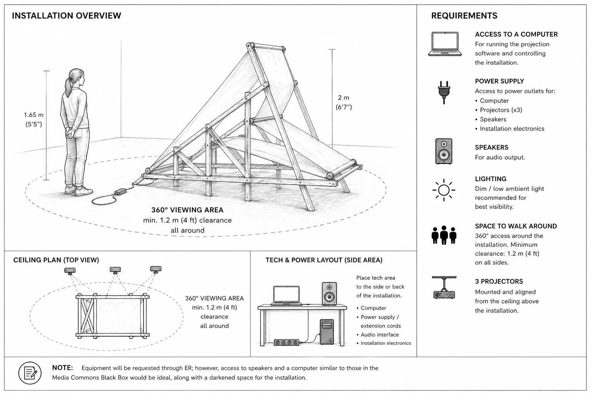

# Convey me

**Sofía Bernasconi, 2025–2026**
Kinetic installation · video projection · custom software
Approx. 300 × 200 × 80 cm · infinite loop

[](https://www.youtube.com/watch?v=naS8u7d6TRU)

*Click the image to watch the documentation video.*

---

## About the work

*Convey me* is a kinetic installation in which my own naked body is transported, stretched and reconfigured without rest. A wooden truss structure drives a continuous loop of fabric over conveyor-belt rollers. Onto that moving fabric I project video of my body, deformed twice over: once by the geometry of the structure, and again by custom code that stretches the image as it advances.

Mechanics, projection and code work as a single system. Without the structure there is no image, no motion, no body to show.

More about the work: [sofiabernasconi.com](https://sofiabernasconi.com)

Exhibited at the **ITP / IMA Spring Show 2026**, New York University.

---

## How it works

The installation has two independent systems that run at the same time:

```
MOTION                                  IMAGE
potentiometer                           computer
     │                                     │
  Arduino  (motor_control.ino)          p5.js  (sketch.js)
     │                                     │
BTS7960 motor driver                    ceiling-mounted projectors
     │                                     │
DC gearmotor ──► rollers ──► fabric belt ◄─┘
```

- **Motion.** A potentiometer sets the speed and direction of the DC motor through a BTS7960 driver. The motor turns the rollers that carry the fabric loop.
- **Image.** A p5.js sketch plays the video of the body, moves it along the belt, and stretches it inside a defined section of the image. The projectors cast this image onto the moving fabric.

The two systems run on separate clocks: the motor speed is set by hand, and the projection advances at a fixed speed per frame. They are tuned to match visually.

---

## Repository structure

```
arduino/
  motor_control/motor_control.ino   Motor control used in the installation
  motor_test/motor_test.ino         Early motor + potentiometer test
p5_projection/
  index.html                        Page that loads the sketch
  sketch.js                         Video projection and stretch effect
docs/
  installation-plan.jpg             Installation plan and technical requirements
```

---

## Hardware

| Part | Notes |
|---|---|
| Wooden truss structure | 1×2" pine battens |
| Fabric belt | Raw canvas, continuous loop |
| Conveyor-belt rollers | |
| DC gearmotor | [Pololu 150:1 Metal Gearmotor 37D, 24V, with 64 CPR encoder](https://www.pololu.com/product/4697) (encoder not used in this version) |
| Motor driver | BTS7960 (43A H-bridge) |
| Microcontroller | Arduino |
| Potentiometer | 10kΩ, speed and direction control |
| Power supply | 24V for the motor |
| Projectors | Mounted overhead, aligned to the belt |
| Computer | Runs the p5.js sketch in a browser |

### Wiring (`motor_control.ino`)

| Arduino | Connects to |
|---|---|
| A0 | Potentiometer wiper (outer pins to 5V and GND) |
| 5 | BTS7960 RPWM |
| 6 | BTS7960 LPWM |
| 5V | BTS7960 R_EN and L_EN (both enable pins tied high), BTS7960 VCC |
| GND | BTS7960 GND, potentiometer GND |

The motor connects to the BTS7960 M+ and M− outputs, and the 24V supply to B+ and B−.

The test sketch (`motor_test.ino`) uses a slightly different wiring: potentiometer on **A7**, and the enable pins driven from Arduino pins **7** (R_EN) and **8** (L_EN).

---

## Running the code

### Arduino

1. Open `arduino/motor_control/motor_control.ino` in the Arduino IDE.
2. Select your board and port, and upload.
3. Turning the potentiometer away from the center runs the motor. The center position stops it. One side runs forward, the other side runs in reverse.
4. Open the Serial Monitor at **115200 baud** to see the potentiometer value.

Adjustable values at the top of the sketch:
- `deadZone`: width of the stop zone around the center of the potentiometer.
- `maxPWM`: maximum motor speed (0–255).

### p5.js projection

1. Place the video file in the `p5_projection/` folder with the name `convey-me-nude-mask-white-background.mp4`, or change the file name in `sketch.js`. The video is kept out of this repository.
2. Serve the folder with a local server. Browsers block video loading from a file opened directly. For example:
   ```
   cd p5_projection
   python3 -m http.server
   ```
   Then open `http://localhost:8000`.
3. Click on the canvas to start the video if the browser blocks autoplay.

Adjustable values at the top of `sketch.js`:
- `speed`: how many pixels the image moves per frame (negative values move it in the other direction).
- `x1`, `x2`: start and end of the section where the body is stretched.
- `stretchAmount`: intensity of the stretch.

The canvas is 4000 × 500 px, to span the projectors side by side.

---

## Installation plan



---

## Credits

Concept, design, fabrication and code: **Sofía Bernasconi**

Thanks to Sophia, Guy, Niko, Octavio, Devan, Ray, Tobi, Rich and Danny.

Developed at ITP (Interactive Telecommunications Program), Tisch School of the Arts, New York University.

---

## License

The code in this repository is released under the [MIT License](LICENSE).

The artwork, images, video and documentation of *Convey me* are © Sofía Bernasconi, all rights reserved.
